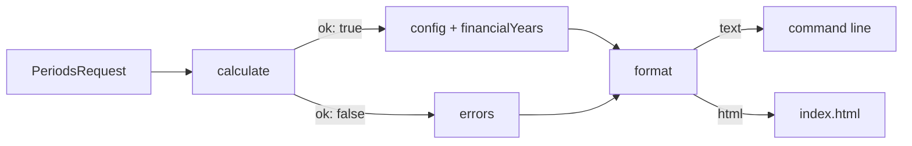

# Accounting Periods

Source: https://github.com/Ironstone/accounting-periods

A small TypeScript library, command line and web page that turn a start date into accounting
periods, numbered within a financial year, grouped by year with the day count of each year.

Read in this order: this file → [planning.md](planning.md) → [decisions.md](decisions.md) →
[testing.md](testing.md) → [progress.md](progress.md) → [interview-notes.md](interview-notes.md).

---

## 1. The problem

The original brief is in [accounting-periods.md](accounting-periods.md). In short:

| Ask | Detail |
|---|---|
| Input | a start date, for example `2020-07-02` |
| Period | one calendar month |
| Numbering | 1 to 12, where period 12 is the month that ends the financial year (30 June) |
| Output | a potentially infinite list of periods, grouped by financial year, with the days in each year |
| Snapping | `2020-07-02` gives a first period of `2020-07-01` to `2020-07-31`, number 1 |

Brian then widened it:

| Extra ask | Detail |
|---|---|
| Configurable year | any start day and month, so a calendar year or any 12-month year works |
| Configurable period | week, fortnight, month or quarter, so the periods per year can be 52/53, 26/27, 12 or 4 |
| Defaults everywhere | every option has a default; new behaviour first asks "is this a new parameter?" |
| Calculate / format split | a typed request in, a typed response (with errors) out; a separate format step for text or HTML |

---

## 2. What was built



| Piece | File | What it does |
|---|---|---|
| Contracts and defaults | [src/types.ts](src/types.ts) | request, response, format options, `DEFAULTS` |
| Calculate | [src/calculate.ts](src/calculate.ts) | validates, applies defaults, generates and groups. Never throws |
| Format | [src/format.ts](src/format.ts) | text table matching the brief, or an HTML table |
| Date maths | [src/dates.ts](src/dates.ts) | y/m/d integers only. The one file that touches `Date` |
| Financial year rule | [src/financialYear.ts](src/financialYear.ts) | which year contains a date, its label and day count |
| Period scheme | [src/periods.ts](src/periods.ts) | period boundaries for each length; infinite generator |
| Grouping | [src/grouping.ts](src/grouping.ts) | lazy grouping of the infinite stream into years |
| Command line | [src/cli.ts](src/cli.ts) | arguments → request → text, HTML or JSON |
| Web page | [index.html](index.html), [src/main.ts](src/main.ts) | a form that drives the same two functions |

Three design points carry the solution:

- **Infinite means a generator.** Periods are produced lazily. The response is finite because the caller says how many financial years to take.
- **Grouping is adjacent, not `groupBy`.** A group is emitted as soon as the year changes, so the infinite stream never has to be buffered.
- **One boundary rule for every length.** Period *i* starts at the year start plus *i* lengths, anchored to the year start so months never drift, capped at the year end.

---

## 3. Set up

Requires Node 20 or later. Node 24 was used.

```bash
npm install
```

---

## 4. Test

```bash
npm test            # run the 74 tests once
npm run test:watch  # re-run on change
npm run test:ui     # the same tests in a browser view
npm run typecheck   # strict TypeScript, no emit
```

What the tests cover is tabulated in [testing.md](testing.md). The golden test compares the
text output byte for byte with the brief's sample.

---

## 5. View the results

### 5.1 Command line

```bash
npm run cli -- 2020-07-02                                      # the brief's example
npm run cli -- 2020-01-15 --fy-start 01-01 --period quarter     # calendar year, quarters
npm run cli -- 2020-07-02 --period week --remainder extendLastPeriod --years 1
npm run cli -- 2020-02-29 --period week --whole-first-year       # first year from period 1
npm run cli -- 2020-07-02 --date-format long                    # 1 Jul 2020 style dates
npm run cli -- 2020-07-02 --format html                         # HTML fragment
npm run cli -- 2020-07-02 --json                                # the raw typed response
npm run cli -- --help
```

A bad request prints one `Error:` line per problem and exits with code 1. An unknown `--date-format` exits with code 2.

### 5.2 Web page

The page must be **served**, not opened from disk. Browsers block module scripts on `file://`.

```bash
npm run dev                      # source, hot reload, prints a local URL
npm run build && npm run preview # the built copy in dist/, prints a local URL
```

The form has every option from section 6. Results update as you type. Open the
"Resolved configuration" panel to see exactly which values the calculation used, including
defaults. If you see a "Waiting for the script to run" message, the page was opened from disk.

---

## 6. Options and defaults

### 6.1 Calculation (`PeriodsRequest`)

| Option | Default | Values | CLI flag |
|---|---|---|---|
| `startDate` | today | any `yyyy-mm-dd` | first argument |
| `financialYearStart` | `{ month: 7, day: 1 }` | any day and month; `{ month: 1 }` alone means 1 January | `--fy-start MM-DD` |
| `periodLength` | `'month'` | `week`, `fortnight`, `month`, `quarter` | `--period` |
| `remainderPolicy` | `'shortLastPeriod'` | `shortLastPeriod` (53 weeks, last one short), `extendLastPeriod` (52 weeks, last one long). Ignored for month and quarter | `--remainder` |
| `firstYearScope` | `'fromStartDate'` | `fromStartDate` (first year lists from the period containing the start date), `wholeYear` (first year lists from period 1). Later years are always complete | `--whole-first-year` |
| `financialYears` | `2` | integer ≥ 1 | `--years` |

### 6.2 Format (`FormatOptions`)

| Option | Default | Values | CLI flag |
|---|---|---|---|
| `kind` | `'text'` | `text`, `html` | `--format` |
| `showDays` | `true` | `false` hides the `Days:` line | `--no-days` |
| `columnGap` | `3` | spaces after each date cell in text mode | — |
| `cssClass` | `'periods'` | class on each `<section>` in HTML mode | — |
| `dateFormat` | `'iso'` | `iso` 2020-07-01 · `dmy` 01/07/2020 · `mdy` 07/01/2020 · `long` 1 Jul 2020. Text columns widen to fit; HTML keeps ISO in `<time datetime>` | `--date-format` |

---

## 7. Use it from code

```ts
import { calculate, format } from './src/index';

const response = calculate({ startDate: '2020-07-02', periodLength: 'quarter' });

if (response.ok) {
  console.log(response.config);                 // every option, defaults filled in
  console.log(format(response));                // text table
  document.body.innerHTML = format(response, { kind: 'html' });
} else {
  console.error(response.errors);               // [{ field, code, message }]
}
```

---

## 8. Where the judgement calls are

Every ambiguity in the brief has a row in [decisions.md](decisions.md) with the call, the
reason and how to reverse it. The two most likely to be challenged:

| Decision | Call made | Alternative |
|---|---|---|
| Days for a partially covered year | the whole year's length (365 or 366) | add `coveredDays` beside it |
| Leftover days with weekly periods | 53 periods, the last one short | `remainderPolicy: 'extendLastPeriod'` |
| Start date mid-year | first year lists from the start date's period | `firstYearScope: 'wholeYear'` |
