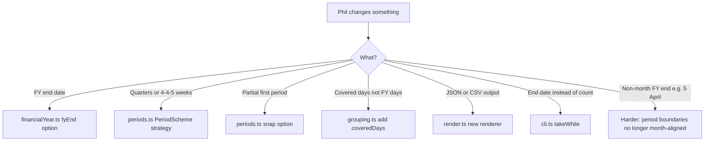

# Decisions — Accounting Periods

Each row is an ambiguity in the brief, the call made, why, and **how to change it** if Phil
takes it another way on the day. Status: ✅ decided · ⚠️ provisional · ❌ reversed.

---

## 1. Interpretation decisions

| ID | Question | Call | Why | How to change | Status |
|---|---|---|---|---|---|
| A1 | Start date is mid-month. Where does period 1 start? | Snap to the **1st of that month** | The brief's example says so explicitly (2020-07-02 → 2020-07-01) | `snapToPeriodStart` in `periods.ts`; a `partialFirstPeriod` option would keep the real start | ✅ |
| A2 | Start date is mid-FY (e.g. Oct). What is the first period number? | **4**, not 1. Numbering is anchored to the FY, not to the start date | "Period 12 is the one that ends the financial year" means numbering is a property of the FY | `periodNumber` in `financialYear.ts` | ✅ |
| A3 | "Days in each financial year" when the first FY is only partly covered | Report the **whole FY length** (365/366), not the covered days | It is phrased as a property of the year, and the sample shows 365 for a full year. A partial figure would vary by start date and mislead | `FinancialYear.days` vs a computed `coveredDays` on the group. Add the second field, keep both | ⚠️ |
| A4 | How is "potentially infinite" delivered? | A **generator** (`function*`); the consumer calls `take(n)` | Only true laziness satisfies "infinite". Arrays would need an arbitrary cap in the library | n/a. This is the core design | ✅ |
| A5 | Where does the bound live? | **Consumer** (CLI/HTML) passes a count of FYs; default 2 | Keeps the library honest; the sample shows two years then `...` | `--years` CLI flag; `years` input on the page | ✅ |
| A6 | FY label format | `2020-2021` (start year to end year). If the FY starts and ends in the same calendar year, the label is a single year `2020` | Matches the sample; avoids a silly `2020-2020` for a December year end | `label()` in `financialYear.ts` | ✅ |
| A7 | Days in FY: inclusive of both ends? | **Inclusive** (1 Jul → 30 Jun = 365) | Matches the sample | `daysBetweenInclusive` in `dates.ts` | ✅ |
| A8 | Date representation | Plain `{ y, m, d }` integers + `Date.UTC` for arithmetic. **Never** a local-time `Date` | DST and time zones are the classic bug in this exercise | `dates.ts` is the only place that touches `Date` | ✅ |
| A9 | The sample's `...` | Rendered output is the **full** second year; the `...` is the brief eliding | Golden test fixture holds the full 24 rows | fixture file | ✅ |

---

## 2. Tooling decisions

| ID | Question | Call | Why | How to change | Status |
|---|---|---|---|---|---|
| T1 | Language | **TypeScript**, strict mode | Brian's call: pure functions, unit tests, thin HTML demo | — | ✅ |
| T2 | Test runner | **Vitest** | Zero config with Vite, TS-native, `test:ui` gives a browser test view for free | Jest + ts-jest would also work | ✅ |
| T3 | Demo | **Vite** dev server + `index.html` + `src/main.ts` | Thinnest wrapper that still hot-reloads; same toolchain as tests | Could be a single static HTML importing an ESM build | ✅ |
| T4 | Module split | `dates` · `financialYear` · `periods` · `grouping` · `render` · `cli` · `main` | One reason to change per file; matches the pivots Phil is likely to ask for | — | ✅ |
| T5 | Dependencies | **None at runtime** (date-fns / Luxon rejected) | Problem is small; hand-rolled maths is fully testable and shows understanding | Drop in `date-fns` if a pivot needs it (e.g. week-based periods) | ✅ |

---

## 3. Likely pivots on the day and where they land

| Pivot | Effort | Touches | Notes |
|---|---|---|---|
| FY ends 31 Dec / 31 Mar | ✅ trivial | one option | already a parameter and tested (F7–F9) |
| Quarterly periods (1–4) | ⚠️ small | `PeriodScheme` | `periodsPerYear` + `monthsPerPeriod` |
| 4-4-5 / 13 × 4-week periods | ⚠️ medium | `PeriodScheme`, `dates.ts` | periods no longer month-aligned; FY days unchanged |
| Keep real start date in period 1 | ✅ trivial | `periods.ts` | option flag |
| Days covered instead of FY days | ✅ trivial | `grouping.ts` | add field, renderer picks |
| JSON / CSV output | ✅ trivial | `render.ts` | groups are plain data |
| Stop at an end date | ✅ trivial | consumer | `takeWhile(p => p.start <= end)` |
| FY ends 5 April (UK) | ❌ larger | everything month-aligned | period = month no longer holds; discuss rather than build |

---

## 4. Reversed decisions

| ID | Was | Now | When | Why |
|---|---|---|---|---|
| T1 | C# + xUnit (my first suggestion) | TypeScript + Vitest + HTML demo | 14:28 | Brian: the choice must cover testing **and** display; TS gives both in one toolchain |

---

## 5. Decisions added after Brian's parameter requirements (14:36)

| ID | Question | Call | Why | How to change | Status |
|---|---|---|---|---|---|
| A10 | Weeks and fortnights do not divide 365/366 days. What happens to the leftover? | New parameter `remainderPolicy`. Default **`shortLastPeriod`**: 53 weekly periods, the last one 1 or 2 days long | Keeps every boundary honest and every full period the same length. The alternative (52 periods, last one 8 or 9 days) is one enum value away | `remainderPolicy: 'extendLastPeriod'` | ✅ |
| A11 | `calculate` returns a finite object, but the stream is infinite. Where is the bound? | New parameter `financialYears`, default **2** | A typed response cannot be infinite. The generator stays infinite inside; the facade takes N years. The sample shows two years | change the default or pass a value | ✅ |
| A12 | How does the caller know which defaults applied? | Successful response echoes `config` (the fully resolved request) | Rule R8 is only useful if the defaults are visible | — | ✅ |
| A13 | Default for `startDate`? | **Today** (UTC) | Every option must have a default. Today is the only sensible one | pass a date | ✅ |
| A14 | Monthly periods when the FY starts mid-month (e.g. 15 July)? | Periods run 15 Jul to 14 Aug, etc. Boundaries are anchored to `fy.start + i months`, clamped to month length | One algorithm covers all four lengths. Anchoring to the FY start avoids drift after short months | — | ✅ |
| A15 | Period number when `startDate` is mid-year with weekly periods? | Still anchored to the FY (e.g. week 15), same as months | Consistent with A2 | — | ✅ |
| A16 | Where does validation live? | In `calculate`, returning `ok: false` with one error per bad field; never throws | Brian asked for errors in the response object | add codes to `ValidationError` | ✅ |

---

## 6. Learned while coding (14:45–14:52)

| ID | Question | Call | Why | How to change | Status |
|---|---|---|---|---|---|
| A17 | How does the CLI run TypeScript? | `tsx` | Vitest 5 no longer ships `vite-node`; Node 24 strips types but needs `.ts` import extensions | switch imports to `.ts` extensions and run `node src/cli.ts` with no extra dependency | ✅ |
| A18 | Text output newline rules | One blank line **between** years, one trailing newline at the end, none after the last row | The golden test caught a doubled newline; the brief's sample has no trailing blank | `formatText` joins | ✅ |
| A19 | Where does "today" come from in `calculate`? | Optional `now: Date` argument, defaulting to `new Date()` | Keeps `calculate` pure for tests (V1 uses a fixed clock) without a mocking library | — | ✅ |
| A20 | `remainderPolicy` on month and quarter? | Ignored. 12 months is exactly one year, so there is never a remainder | Applying it would wrongly merge a short February | tested L5b | ✅ |
| A21 | Is `financialYears` capped? | No | Not asked for; noted as a risk | one validation line | ⚠️ |
| A22 | Demo page: cleared start-date field | Treated as "not supplied", so the default (today) applies | Rule R8: every option has a default; an empty field is the UI's way of not supplying one | `main.ts` | ✅ |
| A23 | How to test the browser glue without a browser | happy-dom environment in Vitest, loading the **real** `index.html` markup | Keeps one runner; catches wiring bugs. happy-dom quirks are worked around in the test, never in the page (testing.md §5) | Playwright for a real-browser check | ✅ |
| A24 | Page opened from disk shows nothing (Brian, 14:58) | Placeholder text in `#output` explains the cause and the fix; `render()` catches and shows script errors; `base: './'` so `dist/` is relocatable; `npm run preview` added | Browsers block module scripts on `file://`, so a blank page was the only symptom. A page should never be silently blank | — | ✅ |
| A25 | Start date mid-year: should the first year list from period 1 or from the start date? (Brian, 15:03, 29 Feb 2020 weekly showed periods 35–53 only) | New parameter `firstYearScope`. Default **`fromStartDate`** (unchanged behaviour); `wholeYear` lists the first year from period 1 | The brief says "from a given start date", and its own example cannot distinguish the two readings. Both are reasonable, so it is a parameter. Later years are always complete either way | `firstYearScope: 'wholeYear'`, `--whole-first-year`, or the checkbox on the page | ✅ |
