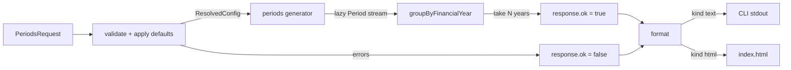

# Planning — Accounting Periods

**Start:** 2026-10-10 14:25 · **Deadline:** 15:25 · **Brief:** [accounting-periods.md](accounting-periods.md)

---

## 1. Problem in one line

From a start date, lazily generate accounting periods, number them within a configurable
financial year, group them by financial year, and show the days in each year. Calculation and
display are separate functions with typed contracts.

---

## 2. Requirements

| # | Requirement | Source | Status |
|---|---|---|---|
| R1 | Period length is configurable: week, fortnight, month (default), quarter | Brian 14:36 | ✅ |
| R2 | Sequence is **potentially infinite** from a start date | brief | ✅ |
| R3 | Period number runs 1..N within the FY; N depends on period length (12, 4, 52/53, 26/27) | brief + Brian | ✅ |
| R4 | FY start day + month is configurable; default 1 July (ends 30 June) | brief + Brian | ✅ |
| R5 | Group periods by FY; show **days in each FY** | brief | ✅ |
| R6 | A start date inside a period snaps to that period's **start** (2020-07-02 → 2020-07-01) | brief, example | ✅ |
| R7 | Text output matches the sample layout | brief, sample | ✅ |
| R8 | **Everything configurable, every option has a default** | Brian 14:36 | ✅ |
| R9 | `calculate(request) → response`: strongly typed in and out; response can carry errors | Brian 14:36 | ✅ |
| R10 | `format(response, options) → string`: text table and HTML table | Brian 14:36 | ✅ |
| R11 | Before adding behaviour, ask whether a new parameter is needed | Brian 14:36 | ✅ |

---

## 3. Parameters

### 3.1 Calculation request (`PeriodsRequest`)

| Parameter | Type | Default | Validation | Why configurable |
|---|---|---|---|---|
| `startDate` | ISO `yyyy-mm-dd` | today | must parse to a real date | the brief's input |
| `financialYearStart` | `{ month: 1–12, day: 1–31 }` | `{ month: 7, day: 1 }` | day must exist in month | calendar year, 1 April, 1 October… any 12-month year |
| `periodLength` | `'week' \| 'fortnight' \| 'month' \| 'quarter'` | `'month'` | must be a member of the enum | Brian's first-pass list |
| `remainderPolicy` | `'shortLastPeriod' \| 'extendLastPeriod'` | `'shortLastPeriod'` | enum | weeks/fortnights never divide 365/366 exactly. See decisions A10 |
| `firstYearScope` | `'fromStartDate' \| 'wholeYear'` | `'fromStartDate'` | enum | a mid-year start can list the first year from the start date or from period 1. Added 15:05, see decisions A25 |
| `financialYears` | integer ≥ 1 | `2` | integer, ≥ 1 | the response is a finite object, so the caller bounds the infinite stream |

### 3.2 Format options (`FormatOptions`)

| Parameter | Type | Default | Why configurable |
|---|---|---|---|
| `kind` | `'text' \| 'html'` | `'text'` | the two displays asked for |
| `dateFormat` | `'iso' \| 'dmy' \| 'mdy' \| 'long'` | `'iso'` | Brian asked for it at 15:09; display-only so it lives in `format` |
| `columnGap` | integer | `3` | the sample pads with 3 spaces after a 10-char date |
| `showDays` | boolean | `true` | Phil may want a terser table |
| `cssClass` | string | `'periods'` | lets the HTML host style it |

---

## 4. Contracts

### 4.1 Response (`PeriodsResponse`) — discriminated union

```ts
type PeriodsResponse =
  | { ok: true;  config: ResolvedConfig; financialYears: FinancialYearGroup[] }
  | { ok: false; errors: ValidationError[] }

interface FinancialYearGroup {
  label: string;           // "2020-2021" or "2020" for a calendar year
  start: IsoDate; end: IsoDate;
  days: number;            // whole FY length
  periodsInYear: number;   // 12, 4, 53, 27 …
  periods: Period[];       // from startDate onward, or the whole year when firstYearScope = wholeYear
}
interface Period { start: IsoDate; end: IsoDate; number: number; days: number }
interface ValidationError { field: keyof PeriodsRequest | 'request'; code: string; message: string }
```

`config` echoes every option **after defaults were applied**, so the caller always sees what
was actually used.

### 4.2 Expected text output

```
Financial Year 2020-2021:
Days: 365
Periods:

Start        End          Period Number
2020-07-01   2020-07-31   1
```

* `Start` and `End` cells are the widest rendered date (10 chars for ISO) + `columnGap` spaces.
* One blank line between financial years.

### 4.3 Expected HTML output

One `<section class="periods">` per FY with `<h2>`, a `<p>` for days, and a `<table>` with a
`<thead>` and one `<tr>` per period. Date cells are `<time datetime="iso">rendered</time>`. Errors render as `<p role="alert">`.

---

## 5. Architecture



| Module | File | Responsibility | Pure? |
|---|---|---|---|
| Types + defaults | `src/types.ts` | request, response, options, `DEFAULTS`, `resolveConfig` | ✅ |
| Date helpers | `src/dates.ts` | y/m/d integers, `Date.UTC` arithmetic, ISO parse/format | ✅ |
| FY rule | `src/financialYear.ts` | FY containing a date for a given `financialYearStart`; label; days | ✅ |
| Period scheme | `src/periods.ts` | period boundaries inside an FY for a `periodLength` + `remainderPolicy`; infinite generator from a start date honouring `firstYearScope` | ✅ |
| Grouping | `src/grouping.ts` | adjacent grouping of the stream into FY groups, lazy | ✅ |
| Calculate | `src/calculate.ts` | `calculate(request): PeriodsResponse` | ✅ |
| Format | `src/format.ts` | `format(response, options): string`; `formatText`, `formatHtml` | ✅ |
| CLI | `src/cli.ts` | args → request → calculate → format text / html / json → stdout, exit code | side effects |
| Demo | `index.html`, `src/main.ts` | form → request → calculate → format text or html → DOM; shows resolved config | side effects |

### Period boundary algorithm (one rule for every length)

1. Find the FY containing the date. `fy.end = fy.start + 1 year − 1 day`.
2. Period *i* starts at `advance(fy.start, i)` where advance is `+i×7d`, `+i×14d`, `+i months`, `+i×3 months`. Anchoring to `fy.start` (not the previous period) stops month-end drift.
3. A period ends the day before the next start, **capped at `fy.end`**.
4. If the last period is shorter than a full one and `remainderPolicy = extendLastPeriod`, merge it into the previous period.
5. `periodsInYear` is whatever step 4 leaves. Months always give 12, quarters 4, weeks 52 or 53, fortnights 26 or 27.

---

## 6. Tooling

| Concern | Choice | Why |
|---|---|---|
| Language | TypeScript (strict) | Brian's call; types are the contract |
| Runtime | Node 24 (installed) | no install needed |
| Tests | Vitest | TS-native, zero config, same config as Vite |
| Demo | Vite + plain `index.html` | thinnest HTML wrapper with hot reload |
| Test UI (stretch) | `@vitest/ui` | browser view of test results |
| DOM test | happy-dom | runs the real index.html in Vitest |

---

## 7. Time-boxed plan (revised 14:40)

| Slot | Time | Task | Done |
|---|---|---|---|
| 0 | 14:25–14:40 | Review brief, tracking docs, parameter model | ✅ |
| 1 | 14:40–14:45 | npm scaffold, tsconfig, scripts, `types.ts` with defaults | ✅ |
| 2 | 14:45–14:55 | `dates.ts`, `financialYear.ts` + tests | ✅ |
| 3 | 14:55–15:05 | `periods.ts` (all four lengths), `grouping.ts` + tests | ✅ |
| 4 | 15:05–15:12 | `calculate.ts` with validation, `format.ts` text + golden test | ✅ |
| 5 | 15:12–15:20 | `format.ts` html, `cli.ts`, `index.html` demo | ✅ |
| 6 | 14:50–14:55 | Final run, update docs (ran early) | ✅ |
| 7 | 14:58–15:08 | Brian's follow-ups: README, blank page from disk, `firstYearScope` | ✅ |
| 8 | 15:09–15:14 | Publish to GitHub, `dateFormat` option | ✅ |
| 9 | 15:15–15:22 | Regression, cleanup, docs sweep, final push | ✅ |

---

## 8. Out of scope (deliberately)

* Time zones and locale-aware date formatting (dates are pure y/m/d; `dateFormat` offers four fixed styles).
* 4-4-5 and 13×4-week retail calendars (would be new `periodLength` members).
* Non-month-aligned FY ends like UK 5 April **are** supported by the algorithm (FY start is any day) with tests L6 and L7 for mid-month FY starts.
